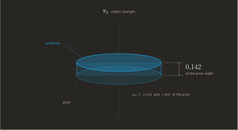
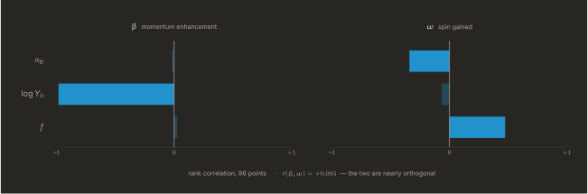
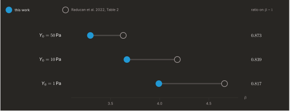
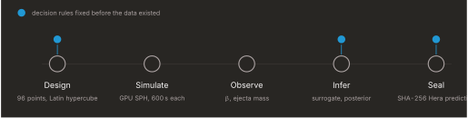
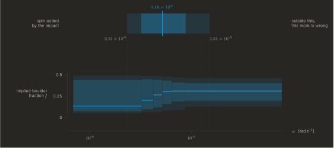

<div align="center">

# DART-RIFT

### Reading the interior of an asteroid from the one number DART left behind — and sealing the prediction before Hera arrives to check it.

[](https://doi.org/10.5281/zenodo.23284193)
[](LICENSE)
[](docs/sonuclar/havuz_posterior_girdi.csv)
[](docs/onkayit/)

<br>



</div>

<br>

**In one paragraph.** DART hit an asteroid and left one number behind. Three
properties of the interior could each explain that number, and one number cannot
separate three things. So this project measured exactly how much *can* be
separated — it turns out to be one direction, matrix strength — then measured
which second observation would open the rest, and sealed that prediction before
ESA's Hera gets there to check it.

| if you are… | start here |
|---|---|
| new to the project | [The question](#the-question) → [The answer](#the-answer) |
| looking for evidence | [Validation](#does-the-code-hold-up) · [How it is locked](#how-it-is-locked) |
| looking for the prediction | [Sealed prediction for Hera](#a-sealed-prediction-for-hera) |
| going to run it | [Reproduce](#reproduce) |
| checking the limits | [What this work does not claim](#what-this-work-does-not-claim) |

<br>

## The question

In September 2022, NASA's DART spacecraft struck the asteroid Dimorphos and left
behind **a single number**: the momentum enhancement factor `β`. That number
depends on what the asteroid is made of — a loose rubble pile and a coherent
rocky body do not recoil the same way.

So the obvious move is to run the inference backwards, from `β` to the interior.
But the interior has three unknowns:

| | symbol | what it is |
|---|:---:|---|
| **Boulder porosity** | `α_b` | how much void sits inside the large boulders |
| **Matrix strength** | `Y₀` | cohesive strength of the fine material between them |
| **Boulder fraction** | `f` | how much of the body's volume the boulders occupy |

One scalar cannot determine three numbers. That is not a difficulty to be
engineered away; it is arithmetic. So this project does not ask *"what is the
interior?"* It asks the question that actually has an answer:

> **How many directions of a three-dimensional interior can one scalar
> observation constrain, and which ones?**

It does not guess. It measures.

<br>

## The answer

Across all 96 locked design points of the production campaign, the Fisher
information of the forward model was decomposed and compared against a threshold
fixed before any of the data existed.

| direction | posterior width, relative to prior | verdict |
|---|:---:|---|
| **first** — almost exactly matrix strength `Y₀` | **0.142** | learned |
| second | 0.930 | not learned |
| third | 1.000 | untouched, by rank |

The figure above is that table drawn to scale. The sphere is the prior; the disc
is what remains after the measurement. It is flattened along one axis, and
*nothing at all* happens along the other two.

Three consequences, each measured rather than argued:

**One direction, and it can be named.** The leading eigenvalue clears the locked
threshold at **93 of 96** points. The second clears it **nowhere** — its largest
value anywhere in the design is `33.09`, against a threshold of `36`. The axis
that gets learned is matrix strength: dominant at **90 of 96** points, with a
median share of `0.999` of the learned direction.

**Precision does not rescue it.** Shrinking the observational error by a factor
of 1000 moves the second eigenvalue only from `2.35` to `4.17`. Error bars change
how heavily a row counts, not which way it points. The remedy is not a better
`β`; it is a second observable whose gradient genuinely differs — and the median
angle between the two gradients already available here is `7.95°`.

**This is a statement about the forward model, not about Dimorphos.** The
sensitivity of impact momentum is piled onto one axis. That is why the literature
reports *ranges* for porosity and boulder fraction while constraining strength
more tightly. This work measures the reason.

<br>

## The way out, measured

If the remedy is a second observable with a different gradient, the obvious next
question is *which one*. That was measured too, on the same 96 completed runs:
the **spin the impact added to the body**, recovered from the angular momentum
of the bound material in the very same state files, needing no extra simulation.

<div align="center">

</div>

| observable | `α_b` | `log Y₀` | `f` |
|---|---:|---:|---:|
| `β` — momentum enhancement | −0.019 | **−0.986** | +0.026 |
| `ω` — spin gained | −0.342 | −0.068 | **+0.474** |

The two rows are almost disjoint, and the two observables are nearly orthogonal:
`r(β, ω) = +0.085`. `β` is an almost pure readout of matrix strength. `ω` is
blind to strength and is the one quantity here that responds to the **boulder
fraction** — the axis `β` cannot see at all.

That is the whole argument for the next measurement, and it is why the sealed
prediction below is about spin rather than about a better `β`.

<br>

## Does the code hold up?

The solver is an independent GPU SPH implementation written for this project:
NVIDIA Warp, FP64, Wendland C2 kernel, Tillotson equation of state, P–α
porosity, Grady–Kipp damage, Barnes–Hut self-gravity. Every GPU kernel has an
independent NumPy FP64 reference and the two are cross-checked, typically
agreeing to better than `1e-8`.

An independent code is worth nothing until it is checked against references it
must reproduce.

| scenario | reference | measured | threshold |
|---|---|---|---|
| Sod shock tube | exact Riemann | shock speed `0.08%`, worst post-shock `0.80%` | 3–5% |
| Sedov–Taylor blast | similarity solution | shock radius `4.46%` | 5% |
| Mass conservation | — | `0.00e+00` | machine precision |
| Momentum conservation | — | `8.39e-16` | `1e-6` |
| Energy conservation | — | `0.432%` | 0.5% |
| Elastic wave speed | `4593 m/s` theoretical | `4458 m/s` → `2.96%` | 3% |
| Taylor bar, copper | experiment `0.60–0.80` | `L/L₀ = 0.731`, energy `0.083%` | 1.5% |

Margins are reported, not hidden: the elastic wave result sits at `2.96%` against
a `3%` threshold. Where a criterion passes narrowly, its behaviour was studied
separately — that error converges to zero with resolution, while the Sedov error
settles onto a floor near `3.9%` that is model-form error rather than
discretisation.

Then the harder test: the same configuration against Bern SPH results published
in *Astronomy & Astrophysics*.

<div align="center">

</div>

| `Y₀` | this work | Raducan et al. 2022 | ratio on `β − 1` |
|---:|---:|---:|---:|
| 50 Pa | 3.295 | 3.63 | 0.873 |
| 10 Pa | 3.667 | 4.18 | 0.839 |
| 1 Pa | 3.992 | 4.66 | 0.817 |

The trend is reproduced, the locked robustness criterion holds (`≤ 0.20`), and
total energy drifts by `−0.91%` across the run. A fourth independent
implementation landing **13–18% below** a published benchmark is a useful data
point in a field that publishes dedicated code-comparison papers.

One more check comes from the ejecta rather than from the momentum. Fitting the
cumulative mass–velocity distribution `M(>v) ∝ v^(−3μ)` across the production
pool gives an ejecta scaling exponent of **`μ = 0.4347`**, fitted successfully at
`95` of `96` points — inside the Housen–Holsapple range of `0.40 – 0.55`. The
solver was never tuned to land there; it is an independent consistency check on
the excavation physics.

<br>

## How it is locked

A result is only worth something if the rules were not chosen after seeing the
answer. They were not.

<div align="center">

</div>

Every marked stage has a protocol document committed **before** the runs it
governs: the design (96 Latin-hypercube points, fixed seed), the posterior recipe
with its identifiability threshold, and the Hera predictions. When a later result
contradicted a hypothesis, the threshold stayed where it was and the hypothesis
was recorded as failed. That is what locking is for.

Two predictions for ESA's Hera mission are sealed with SHA-256 and can be
verified by anyone:

```bash
python scripts/muhur_dogrula.py
```

The verifier is deliberately strict about its own limits. It separates *"the seal
is intact"* from *"the seal is traceable to specific input files"*, and reports
the second as missing where it is missing rather than quietly passing.

Two checks stand behind the posterior itself, both run before anything was
sealed:

- **Simulation-based calibration.** Rank statistics over repeated
  prior-predictive draws are uniform on all three axes
  (`p = 0.868 / 0.074 / 0.299`). The posterior is calibrated under its own
  assumptions — which is a statement about the inference, not about the physics.
- **The model reaches the observation.** History matching gives an implausibility
  minimum of `I_min = 0.325`, with `34.04%` of the prior volume compatible with
  the DART measurement. Had no interior reproduced the observed `β`, this number
  would have come out above 3 and nothing downstream would mean anything.

The locking is not decorative. Partway through, an input column turned out to
hold the wrong quantity, inflating a modelled value by a factor of `1.437`. Three
published judgements were **withdrawn**, the analysis re-run, and the corrected
values published beside the originals. No line was deleted; the retraction and
its full diff are part of the permanent record, and the headline identifiability
result survived it unchanged.

<br>

## A sealed prediction for Hera

The identifiability result says that `β` alone buys one direction. The way out
is a second observable whose gradient points somewhere else — and this project
measured which one: **the spin the impact added to Dimorphos.**

ESA's Hera mission arrives at the Didymos system to survey what DART left
behind. So the prediction was written down and sealed first.

<div align="center">

</div>

| quantile | added spin `ω` [rad s⁻¹] |
|---|---:|
| `q05` | 2.31 × 10⁻⁶ |
| `q16` | 3.20 × 10⁻⁶ |
| **median** | **5.18 × 10⁻⁶** |
| `q84` | 8.77 × 10⁻⁶ |
| `q95` | 1.51 × 10⁻⁵ |

**The falsification rule was fixed in advance:** a measured value outside
`q05 – q95` makes this work *inconsistent* with Hera, inside makes it
*consistent*, and the quantile reached is to be written down either way.

The lower panel is the part that matters scientifically. It is the map from a
spin measurement to the interior axis that `β` cannot see:

| if Hera measures `ω` | implied boulder fraction `f`, median (`q16 – q84`) |
|---|---:|
| below 3.2 × 10⁻⁶ | 0.13 (0.07 – 0.44) |
| 3.2 – 4.2 × 10⁻⁶ | 0.20 (0.10 – 0.45) |
| 4.2 – 5.2 × 10⁻⁶ | 0.26 (0.12 – 0.44) |
| 5.2 – 6.4 × 10⁻⁶ | 0.30 (0.16 – 0.43) |
| 6.4 – 8.6 × 10⁻⁶ | 0.31 (0.19 – 0.41) |
| above 8.6 × 10⁻⁶ | 0.31 (0.19 – 0.40) |

This is the shape a result should take when one observable cannot resolve three
unknowns. Not a point estimate that hides the degeneracy — a stated map from a
future measurement to a parameter, sealed where it cannot be adjusted afterwards.

A second record seals the transient crater, and it is reported exactly as the
surrogate produced it:

| | `q05` | median | `q95` |
|---|---:|---:|---:|
| crater volume [m³] | −46.3 | 34.1 | 504.0 |

A negative volume is physically impossible. It was **not clipped**, because
clipping would have narrowed the interval for cosmetic reasons; the fraction of
samples outside the surrogate's training support, `0.285`, is recorded instead
as the direct measure of how far it is extrapolating.

The sealed records also carry their own warnings forward, written before the
numbers: the model's crater is the transient one at 600 s while Hera will see
the final crater; the model's spin is what the impact added, while Hera will see
a state evolved for four years; and — the one worth reading twice —

> With a single scalar observable, most of the width of this prediction is the
> width of the prior. **A narrow interval here would be a sign of error, not of
> success.**

<br>

## What this work does not claim

This section matters as much as the results.

- **No point estimate for `(α_b, Y₀, f)`.** The degeneracy is measured. Quoting a
  best-fit triple would be hiding it.
- **No new physics.** The material models are the literature's. The contribution
  is an independent implementation and a measurement of what the inference can
  and cannot recover.
- **Resolution convergence is not achieved.** The locked verdict is
  `NOT CONVERGED`: differences grow as resolution increases. Absolute values are
  therefore not reported as findings; separately-tested contrasts are.
- **Resolution error is a bias, not scatter.** All 7 probe points moved the same
  way, by a factor of `3.22` in `Y₀` (`p = 0.0156`). Folding that into the noise
  term as variance would be wrong, and this is the measurement that says so.
- **Crater depth is structurally unmeasurable here.** In the weak-matrix regime
  the unescaped ejecta covers the crater: the obstruction and the thing being
  measured are the same material. The route was scored against a locked criterion,
  reached `1 of 4`, and was reported as insufficient.
- **The boulder-fraction axis is the weakest.** The production scene generator
  saturates this knob: a requested `0.05 – 0.50` is realised as `0.151 – 0.369`,
  and above `0.436` the scenes are identical. Statements about `f` are bounded by
  that, and the defect is on the record.
- **The target is a fitted ellipsoid, not the PDS shape model.** The official
  shape package was retrieved and verified against its published MD5 checksums,
  but production runs use a triaxial ellipsoid of 88.5 × 87.0 × 58.0 m and
  4.298 × 10⁹ kg.
- **Passing engineering gates is not physical validation.** That the solver
  solves the right equations correctly, and that those equations describe the real
  DART impact, are different claims. The second remains open, and the two tables
  above are kept apart for exactly that reason.

<br>

## Reproduce

Every number and every figure on this page regenerates from the repository.
**None of it needs a GPU** — the simulations are already run and their measured
outputs are committed.

**Setup** (Python 3.10–3.12):

```bash
pip install -e ".[dev]"
```

**One minute — check the sealed predictions.** Recomputes the SHA-256 of each
sealed Hera record and reports whether it still matches. Expect
`muhur bozuk 0` and two traceability notes that the verifier raises against
itself.

```bash
python scripts/muhur_dogrula.py
```

**Two minutes — rederive the headline result.** Reads the production pool and
recomputes the Fisher directions. Expect `lambda1 93/96`, `lambda2 0/96`, and
posterior widths `0.142 / 0.930 / 1.000`.

```bash
python scripts/tani_esdogrusallik_96.py docs/sonuclar/havuz_posterior_girdi.csv --json docs/figures/data/identifiability.json
```

**Then the figures.** Needs a LaTeX installation with `lualatex` and
`pdftocairo`; writes the same SVG files this page embeds.

```bash
python scripts/figure_data.py && make -C docs/figures
```

**Half an hour — the full test suite**, 2,735 tests, CPU only:

```bash
python -m pytest -m "not gpu" -q
```

<details>
<summary><b>Running a simulation yourself</b> — this is the part that needs a GPU</summary>

The forward model needs an NVIDIA GPU with FP64 (developed on H100). A single
point of the production campaign at the fine resolution took **44 to 60 hours**
on one H100 — the eight completed fine points cost **373.8 GPU-hours** between
them, and their measured wall times are recorded in
[`docs/sonuclar/ince/ince_kunye.json`](docs/sonuclar/ince/ince_kunye.json).

This is why the measured outputs are committed rather than left to be
regenerated: reproducing the campaign from scratch is a cluster-scale job, but
checking every claim made from it is not.

The campaign driver is [`scripts/faz5_ensemble_merdiven.py`](scripts/faz5_ensemble_merdiven.py);
the exact flags used in production are in the Slurm scripts under
[`truba/`](truba/), and the full configuration of a completed run is recorded
alongside its result.
</details>

<br>

## Repository

| path | what is in it |
|---|---|
| [`src/dartrift/warp_core/`](src/dartrift/warp_core/) | GPU kernels: kernel function, neighbours, density, forces, integrator, Tillotson, strength, P–α, Grady–Kipp, Barnes–Hut |
| [`src/dartrift/cpu_reference/`](src/dartrift/cpu_reference/) | an independent NumPy FP64 reference for every kernel |
| [`src/dartrift/setup/`](src/dartrift/setup/) | shape, rubble generator, settling, impactor, scene, refinement |
| [`src/dartrift/observables/`](src/dartrift/observables/) | `β`, ejecta catalogue, crater shape, period interface |
| [`src/dartrift/inference/`](src/dartrift/inference/) | design, forward model, surrogate, posterior, history matching |
| [`docs/truba/`](docs/truba/) | 42 locked protocols — decision rules, written before the runs |
| [`docs/adr/`](docs/adr/) | 65 architecture decision records |
| [`docs/defter/`](docs/defter/) | 98 dated records: what was measured, and what failed |
| [`docs/onkayit/`](docs/onkayit/) | sealed Hera predictions, SHA-256 |
| [`docs/sonuclar/`](docs/sonuclar/) | the production pool and the measurements drawn from it |
| [`docs/figures/`](docs/figures/) | the figures on this page and the data behind them |
| [`docs/yazismalar/`](docs/yazismalar/) | external expert review, verbatim — several defects here were found by it |
| [`docs/arsiv/`](docs/arsiv/) | superseded working documents, kept and marked as historical |
| [`data_manifest/`](data_manifest/) | retrieved NASA PDS products with verified checksums |
| [`RULES.txt`](RULES.txt) | the four rules nothing in this repository may violate |

Requirement-to-code-to-test-to-evidence mapping:
[`docs/IZLENEBILIRLIK.md`](docs/IZLENEBILIRLIK.md).
The full engineering record, including every gate report and the complete defect
list, is kept in Turkish: [`docs/README-TR.md`](docs/README-TR.md).

The defect log is public on purpose. Problems are numbered, left visible, and
carry their measurements — including the ones still open. A project that reports
only its successes cannot be checked.

<br>

## Scale

| | |
|---|---:|
| Production design points, all completed | 96 / 96 |
| Locked protocols | 42 |
| Architecture decision records | 65 |
| Dated measurement records | 98 |
| Tests, CPU only | 2,735 |
| Lint violations | 0 |

<br>

## Citation

Two things can be cited and they are not interchangeable. Cite the **paper** for
the text, the methods and any number reported here; cite the **software** when
you run, modify or build on the code.

<details>
<summary><b>Paper</b> — for results, methods and reported numbers</summary>

```bibtex
@article{dartrift2026,
  title   = {DART-RIFT. I. Cohesion, Matrix Tension, and Impact-Site
             Sensitivities in Simulations of Dimorphos},
  author  = {Dalar, Ya{\u{g}}{\i}z Ekrem and Saliho{\u{g}}lu, Feyzi Arda
             and Sezer, Nedim Mutlu},
  year    = {2026},
  month   = {10},
  publisher = {Zenodo},
  doi     = {10.5281/zenodo.23284193},
  url     = {https://doi.org/10.5281/zenodo.23284193}
}
```
</details>

<details>
<summary><b>Software</b> — for the code itself</summary>

```bibtex
@software{dartrift_software,
  title   = {DART-RIFT: GPU-accelerated SPH shock-physics engine for
             Dimorphos and Bayesian interior inference},
  author  = {Dalar, Ya{\u{g}}{\i}z Ekrem and Saliho{\u{g}}lu, Feyzi Arda
             and Sezer, Nedim Mutlu},
  year    = {2026},
  license = {MIT},
  url     = {https://github.com/Yagiz-D-Ekrem-Dolar/dart-rift}
}
```
</details>

**Which DOI.** `10.5281/zenodo.23284193` is the *version* DOI and points at that
exact text — use it when you cite a specific number. The *concept* DOI
`10.5281/zenodo.23284192` always resolves to the newest version instead.

[`CITATION.cff`](CITATION.cff) is the machine-readable source for all of the
above, including ORCIDs; GitHub's "Cite this repository" button reads it.

Released under the [MIT License](LICENSE). This page, the figures and the paper
are in English; the locked protocols and dated measurement notes are written in
Turkish, and the full engineering record stays in that language on purpose —
translating a frozen record would mean rewriting it.
